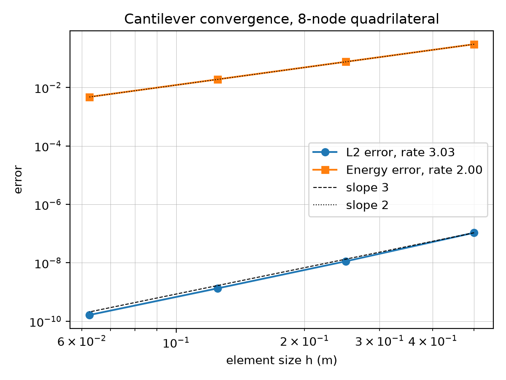
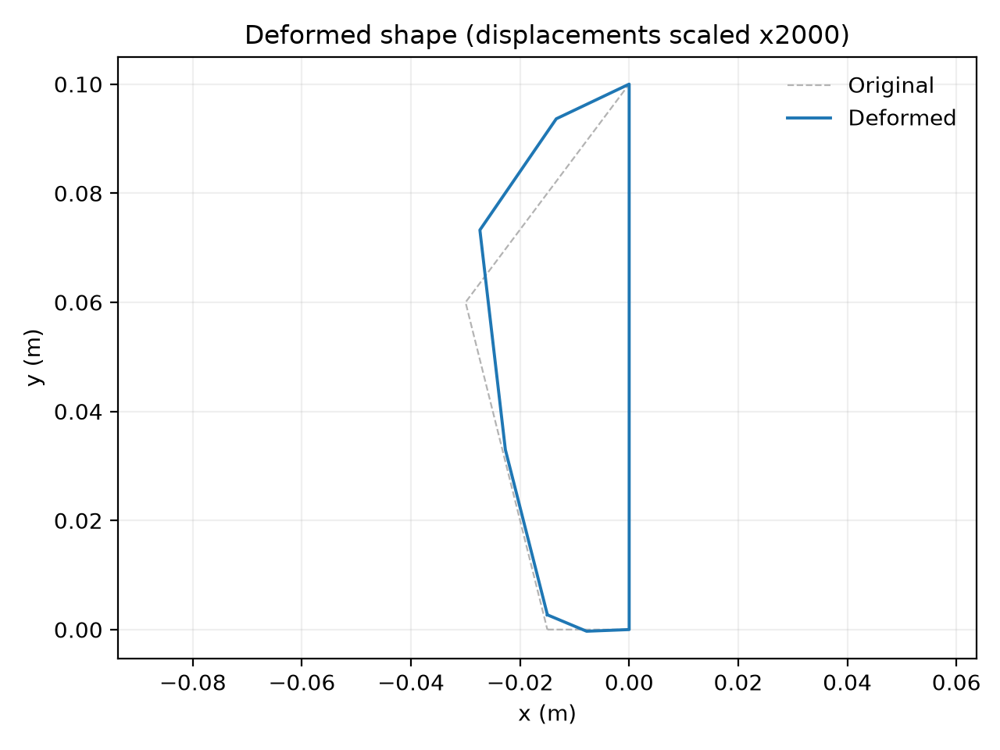
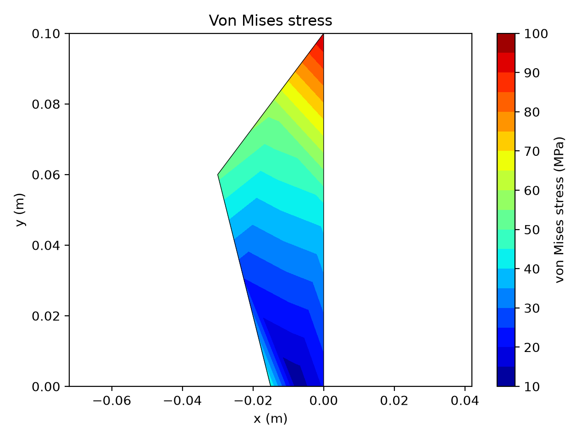
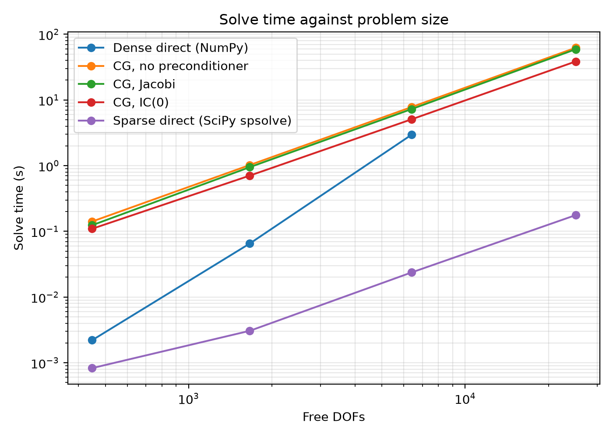
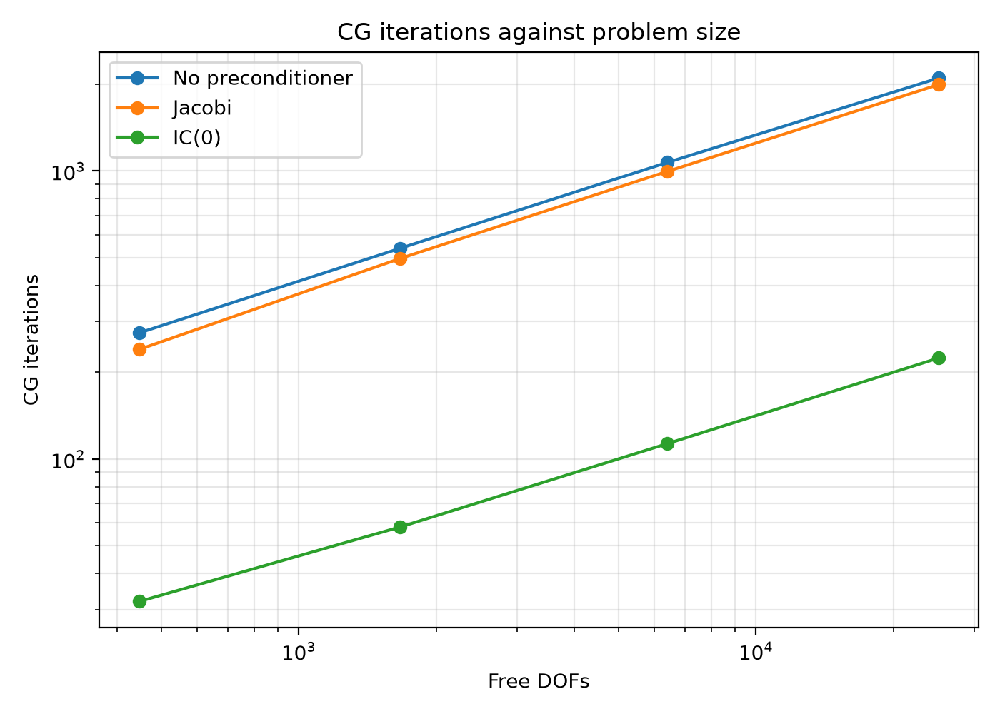
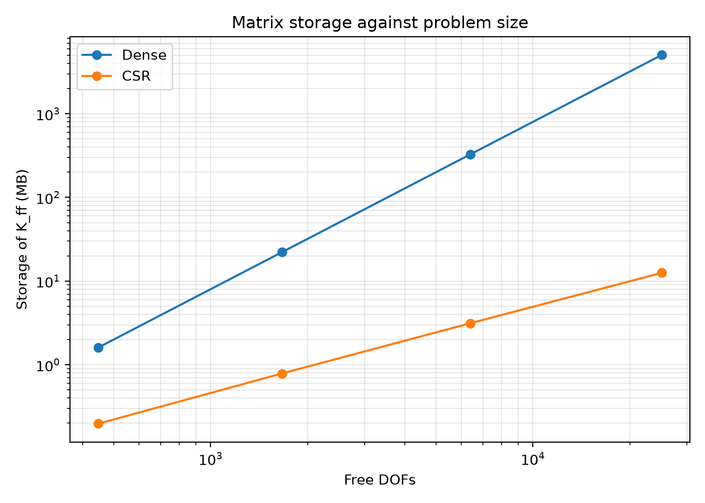

# fe-solver


`fe-solver` is a 2D plane-stress finite element package written in Python. It is built around the 8-node serendipity quadrilateral (Quad8), with the constant strain triangle (CST) included as a second element. The package covers the full chain of a linear elastic analysis: meshing, stiffness assembly, edge loads, solution, stress recovery, error norms and plotting.

Two solution paths are provided. In the first, the stiffness matrix is stored densely and solved directly. In the second, it is stored in compressed sparse row (CSR) format and solved by the conjugate gradient (CG) method, with an optional Jacobi or incomplete Cholesky (IC(0)) preconditioner. The sparse storage, CG and both preconditioners are written in the package itself; SciPy is used only as a reference in the benchmark.

The package was verified through a mesh convergence study against an exact elasticity solution. The L2 norm measures the error in displacement and the energy norm measures the error in strain. The measured convergence rates were 3.03 in the L2 norm and 2.00 in the energy norm. These match the theoretical rates of 3 and 2 for quadratic elements.

## Convergence study

An end-loaded cantilever was used as the verification problem, since it has a closed-form elasticity solution. The beam has a length of 2.0 m, a height of 0.5 m and a thickness of 0.01 m, with E = 209 GPa and ν = 0.3. A load of 1000 N is applied to the right end as a parabolic shear traction. The left end is held at the exact displacements, which are small but not zero. Thus, the finite element problem and the exact solution describe the same beam.

The exact displacement is cubic, so quadratic elements cannot reproduce it exactly. As a result, the error can be measured as the mesh is refined. The absolute errors obtained on four structured Quad8 grids are listed below, where h is the element size.

| Grid   | h (m)  | L2 error (m<sup>2</sup>) | Rate | Energy error (N<sup>0.5</sup>) | Rate |
|--------|--------|--------------------------|------|--------------------------------|------|
| 4 x 1  | 0.5000 | 1.0673e-07               |      | 3.0219e-01                     |      |
| 8 x 2  | 0.2500 | 1.1280e-08               | 3.24 | 7.5897e-02                     | 1.99 |
| 16 x 4 | 0.1250 | 1.3348e-09               | 3.08 | 1.8995e-02                     | 2.00 |
| 32 x 8 | 0.0625 | 1.6345e-10               | 3.03 | 4.7517e-03                     | 2.00 |
| Theory |        |                          | 3    |                                | 2    |

Both measured rates converge to the theoretical values. If the left end is held at zero instead of the exact values, the rates fall well below the theoretical values, because the exact solution is not zero there.



*Both error norms plotted against the element size h on log-log axes. The dashed line has a slope of 3 and the dotted line has a slope of 2.*

## Lifting lug example

The second example is a lifting lug modelled as a single Quad8 element. Three nodes are fully fixed and a vertical load of 58.86 kN is applied at one node. The peak von Mises stress is 95.61 MPa. It occurs at the upper corner of the fixed edge, which is the fixed node closest to the load. The script is self-verifying: it compares its displacements and von Mises stresses against stored reference values and prints whether they match.

| Deformed shape | Von Mises stress |
|:--------------:|:----------------:|
|  |  |
| *Drawn with a scale factor of 2000.* | *Nodal values, plotted on the undeformed shape.* |

## Sparse solver benchmark

The sparse path was compared against a dense direct solve (NumPy) and a sparse direct solve (SciPy `spsolve`). The cantilever above was used on four Quad8 grids, each with about four times the degrees of freedom of the one before. The left end is held at zero and a point load of 1000 N is applied at the top-right corner. CG stops when the residual has fallen to 1e-8 of its starting value. Every solution agrees with the SciPy solution to a relative error of 2e-11 or less. Times are from a single run on the author's machine and are indicative only.

| Grid     | Free DOFs | Dense (s) | SciPy `spsolve` (s) | CG (s) | CG, Jacobi (s) | CG, IC(0) (s) |
|----------|-----------|-----------|---------------------|--------|----------------|---------------|
| 16 x 4   | 448       | 0.0022    | 0.00083             | 0.141  | 0.124          | 0.109         |
| 32 x 8   | 1,664     | 0.065     | 0.0031              | 1.02   | 0.949          | 0.705         |
| 64 x 16  | 6,400     | 2.95      | 0.024               | 7.80   | 7.26           | 5.07          |
| 128 x 32 | 25,088    | not run   | 0.177               | 62.3   | 59.1           | 38.5          |

| Grid     | CG iterations | Jacobi iterations | IC(0) iterations | Dense K<sub>ff</sub> (MB) | CSR K<sub>ff</sub> (MB) |
|----------|---------------|-------------------|------------------|---------------------------|-------------------------|
| 16 x 4   | 274           | 240               | 32               | 1.61                      | 0.197                   |
| 32 x 8   | 538           | 496               | 58               | 22.2                      | 0.786                   |
| 64 x 16  | 1,070         | 996               | 113              | 328                       | 3.14                    |
| 128 x 32 | 2,100         | 1,993             | 224              | 5,035                     | 12.5                    |

| Solve time | CG iterations | Storage of K<sub>ff</sub> |
|:----------:|:-------------:|:-------------------------:|
|  |  |  |

**Storage.** Dense storage grows with the square of the number of unknowns, whereas CSR storage grows in proportion to it. On the largest grid, the dense matrix would need 5.0 GB against 12.5 MB in CSR, so the dense solve was not run.

**Iterations.** The number of CG iterations roughly doubles each time the grid is refined, for all three variants. IC(0) reduces the count by about nine times, but does not change how it grows. Jacobi saves between 5% and 12%, because the diagonal of the stiffness matrix is nearly constant on a uniform mesh.

**Time.** Fewer iterations did not give a proportional saving in time. IC(0) needs about nine times fewer iterations than plain CG, but on the largest grid it is only about 1.6 times faster, because each iteration adds a forward and a backward triangular solve. SciPy's sparse direct solve is about 200 times faster than CG with IC(0) on the largest grid. Its loops run in compiled code, and a sparse direct solve is inexpensive for 2D problems of this size.

**Where the time goes.** Each stage of the IC(0) path was also timed on its own. On the largest grid, the triangular solves take 77% of the solve time, the matrix-vector products 17%, and building the preconditioner 5%. The timed stages add up to within 4% of the measured solve time on every grid. These loops are written in pure Python and are the first candidates for a compiled implementation.

### Choice of preconditioner

IC(0) is incomplete Cholesky with zero fill-in. The factor L keeps exactly the sparsity pattern of the lower triangle of K<sub>ff</sub>, and every stored entry is recomputed, so L L<sup>T</sup> equals K<sub>ff</sub> at every stored position and differs only outside the pattern. A cheaper diagonal-based variant keeps the off-diagonal entries of K unchanged and computes only a new diagonal, but approximates K<sub>ff</sub> less closely. IC(0) was chosen because it is the standard baseline in the literature.

The preconditioner M = L L<sup>T</sup> is never formed. It is applied to a residual by a forward solve with L followed by a backward solve with L<sup>T</sup>. L<sup>T</sup> is built once as its own CSR matrix, because the backward solve needs the columns of L and CSR only gives fast access to rows.

## Usage

The example below solves the cantilever on a single 16 x 4 grid. For brevity, the left end is fixed at zero. The convergence script passes the exact displacements through `fixed_values` instead.

```python
import numpy as np
from fesolver.mesh import structured_quad8
from fesolver.elements.quad8 import Quad8
from fesolver.materials import PlaneStressMaterial
from fesolver.assembly import assembly_stiffness
from fesolver.loads import edge_traction
from fesolver.solver import solve
from fesolver.postprocess import (element_gauss_stresses, element_nodal_stresses,
                                  average_nodal_stresses, von_mises,
                                  plot_deformed_shape, plot_von_mises)

LENGTH, HEIGHT, THICKNESS, LOAD = 2.0, 0.5, 0.01, 1000.0   # m, m, m, N
I = THICKNESS * HEIGHT**3 / 12
steel = PlaneStressMaterial(209e9, 0.3)


def end_traction(x, y):
    """Traction (tx, ty) in pascals on the right end: a parabolic shear."""
    yc = y - HEIGHT / 2
    return (0.0, LOAD / (2 * I) * (HEIGHT**2 / 4 - yc**2))


mesh = structured_quad8(LENGTH, HEIGHT, 16, 4)
K = assembly_stiffness(mesh, Quad8, steel, THICKNESS)

# Load: one (end, middle, end) triplet per element edge on the right end
F = np.zeros(mesh.n_dofs)
for e in range(mesh.n_elements):
    row = mesh.connectivity[e]
    edge_nodes = [row[1], row[5], row[2]]
    if np.allclose(mesh.nodes[edge_nodes][:, 0], LENGTH):
        F += edge_traction(mesh, edge_nodes, end_traction, THICKNESS)

# Supports: every node on the left end; node i owns DOFs 2i and 2i + 1
fixed_dofs = []
for node, (x, y) in enumerate(mesh.nodes):
    if np.isclose(x, 0.0):
        fixed_dofs += [2 * node, 2 * node + 1]

u = solve(K, F, fixed_dofs)

# Stress recovery: Gauss points, then element nodes, then nodal averages
strain, stress = element_gauss_stresses(mesh, u, Quad8, steel)
nodal = element_nodal_stresses(mesh, stress, Quad8)
vm = von_mises(average_nodal_stresses(mesh, nodal))

plot_deformed_shape(mesh, u, 1000, Quad8)
plot_von_mises(mesh, vm, Quad8)
```

For the sparse path, the stiffness matrix is assembled in CSR format and passed to `sparse_solve`. The preconditioner is `None`, `"jacobi"` or `"ic0"`, and `history` holds the relative residual after each CG iteration.

```python
from fesolver.assembly import assembly_stiffness_csr
from fesolver.solver import sparse_solve

K = assembly_stiffness_csr(mesh, Quad8, steel, THICKNESS)
u, history = sparse_solve(K, F, fixed_dofs, preconditioner="ic0")
```

SI units (m, N, Pa) are used throughout the package. The DOF order is `[u1, v1, u2, v2, ...]`.

## Installation and tests

Python 3.10 or later is required. The package was developed on Python 3.12.

```bash
git clone https://github.com/yasinghazaly/fe-solver.git
cd fe-solver
pip install -e ".[dev]"
```

The `dev` extra installs pytest and SciPy. SciPy is needed only for the benchmark.

The test suite contains 142 tests and is run from the repository root:

```bash
pytest
```

Among other checks, the suite confirms that each stiffness matrix has exactly three rigid-body modes, that the sparse assembly and solve reproduce the dense ones, and that CG with each preconditioner reaches the direct solution.

The examples are also run from the repository root. The benchmark takes a few minutes, mostly on the largest grid.

```bash
python examples/cantilever_convergence.py
python examples/lifting_lug.py
python examples/benchmark.py
```

## Folder layout

```
fe-solver/
├── pyproject.toml
├── README.md
├── docs/
│   ├── images/          figures used in this README
│   └── theory.md        derivation of the method
├── examples/
│   ├── cantilever_convergence.py   h-refinement study against the exact solution
│   ├── lifting_lug.py              single Quad8 lug, self-verifying
│   └── benchmark.py                dense, sparse direct and CG solves against problem size
├── fesolver/
│   ├── materials.py     PlaneStressMaterial
│   ├── quadrature.py    Gauss rules in 1D and 2D
│   ├── mesh.py          Mesh class and structured_quad8
│   ├── assembly.py      global stiffness assembly, dense and CSR
│   ├── sparse.py        CSR matrix, IC(0) factorisation and triangular solves
│   ├── iterative.py     conjugate gradients with Jacobi and IC(0)
│   ├── solver.py        dense and sparse solution with prescribed displacements
│   ├── loads.py         consistent edge tractions
│   ├── errors.py        L2 and energy error norms
│   ├── postprocess.py   stress recovery, von Mises and plots
│   └── elements/
│       ├── base.py      abstract element base class
│       ├── quad8.py     8-node serendipity quadrilateral
│       └── cst.py       constant strain triangle
└── tests/               142 tests
```

Library code is kept in `fesolver/`, whereas problem-specific scripts are kept in `examples/`.

## Theory

The Quad8 is an isoparametric element, where the geometry and the displacement are described using the same set of quadratic shape functions. The element stiffness matrix is evaluated through Gauss numerical integration with a 3 x 3 rule. Boundary conditions are applied by partitioning the global system, which allows non-zero displacements to be prescribed. On the sparse path the reduced system is symmetric positive definite, so it is solved by conjugate gradients. Stresses are computed at the Gauss points, extrapolated to the element nodes with a least-squares fit, and then averaged at the nodes shared between elements. The error norms are integrated with a higher-order rule than the element itself. For quadratic elements, the L2 error is expected to fall as h<sup>3</sup> and the energy error as h<sup>2</sup>.

The full derivation is given in [docs/theory.md](docs/theory.md).

## Limitations

- The analysis is 2D plane stress only: linear elastic, isotropic and small strain.
- Only the Quad8 and CST elements are available, with one element type per mesh.
- The sparse path is written in pure Python and is much slower than SciPy's compiled solvers (see the benchmark).
- The sparse path does not check for rigid-body modes. An under-constrained model is not detected: CG does not converge and a warning is raised.
- IC(0) can break down for some symmetric positive definite matrices. A breakdown is detected and reported, but no diagonal shift is applied.
- The nodes are not reordered before the IC(0) factorisation.
- The dense path checks for rigid-body modes with a full eigenvalue decomposition, which dominates its cost above a few thousand DOFs.
- The mesh generator covers structured rectangular Quad8 grids only. There is no mesh import.
- Edge tractions are implemented for Quad8 edges only.
- Point loads are applied by writing directly into the force vector.
- Body forces and thermal loads are not included.
- Convergence was verified for the Quad8 only.

## Author

Yasin Ghazaly